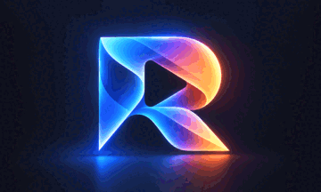

  <picture>
    <!-- Currently ships one dark-background mark. When a light-mode variant is
         ready, save it as assets/logo-light.png and uncomment the line below. -->
    <!-- <source media="(prefers-color-scheme: light)" srcset="assets/logo-light.png"> -->
    
  </picture>

<h1 align="center">RYVEO LAB</h1>

  Building the Future of Cinematic Experiences.

<a href="https://github.com/ryveo-lab/.github/blob/main/profile/README.md">中文</a> · English

---

## About RYVEO LAB

RYVEO LAB is a global cinematic ecosystem exploring the convergence of artificial intelligence and digital filmmaking. We build creative tools, media infrastructure, and open technologies that connect creators, developers, and audiences across the world — with a steady focus on the next generation of storytelling, from AI-assisted production to interactive formats.

## What We Explore

- **AI & Generative Media** — production workflows powered by machine learning and generative models
- **Film Production Technologies** — tooling that supports modern filmmaking, from pre-production to post
- **Creative Development Tools** — developer-facing software for building media experiences
- **Media Processing & Infrastructure** — scalable systems for encoding, distributing, and archiving video
- **Interactive Storytelling** — formats where the story adapts to its viewer and the moment
- **Open Source Engineering** — shared libraries, standards, and practices built publicly

---

## Open Source at RYVEO LAB

We believe the future of media technology will be built in the open. Our tools and infrastructure are designed developer-first, and we are committed to releasing parts of our work as they mature — libraries, standards, and practices that the community can use, study, and improve.

Today we are focused on the foundations: product development and the engineering processes that will shape how we publish. Contribution guides and community governance are already public — the [contributing guide](CONTRIBUTING.md) and [Code of Conduct](CODE_OF_CONDUCT.md) (full detail on the [website community page](https://ryveo-lab.github.io/en/community/)); more substantive open-source releases will follow as projects mature.

## Projects & Repositories

Our public work lives at [organization repositories](https://github.com/orgs/ryveo-lab/repositories), and projects we consider representative of RYVEO LAB are featured here.

### Featured

| Project | Description |
| --- | --- |
| [ryveo-lab.github.io](https://github.com/ryveo-lab/ryveo-lab.github.io) | The official website: bilingual content, brand, and community documentation. |
| [.github](https://github.com/ryveo-lab/.github) | Organization profile and default community files (contributing guide, Code of Conduct). |

---

## Community & Collaboration

RYVEO LAB grows with the people who build on it. Developer, designer, or creator — here is how to take part:

- **Explore our repositories** and follow along as projects are released
- **Contribute to open-source projects** — start with the [contributing guide](CONTRIBUTING.md); all interaction follows the [Code of Conduct](CODE_OF_CONDUCT.md)
- **Share ideas and feedback** on the work you care about

Chat channels and social accounts will be added to this section as they are established.

---

RYVEO LAB — Where Technology Meets Storytelling.
